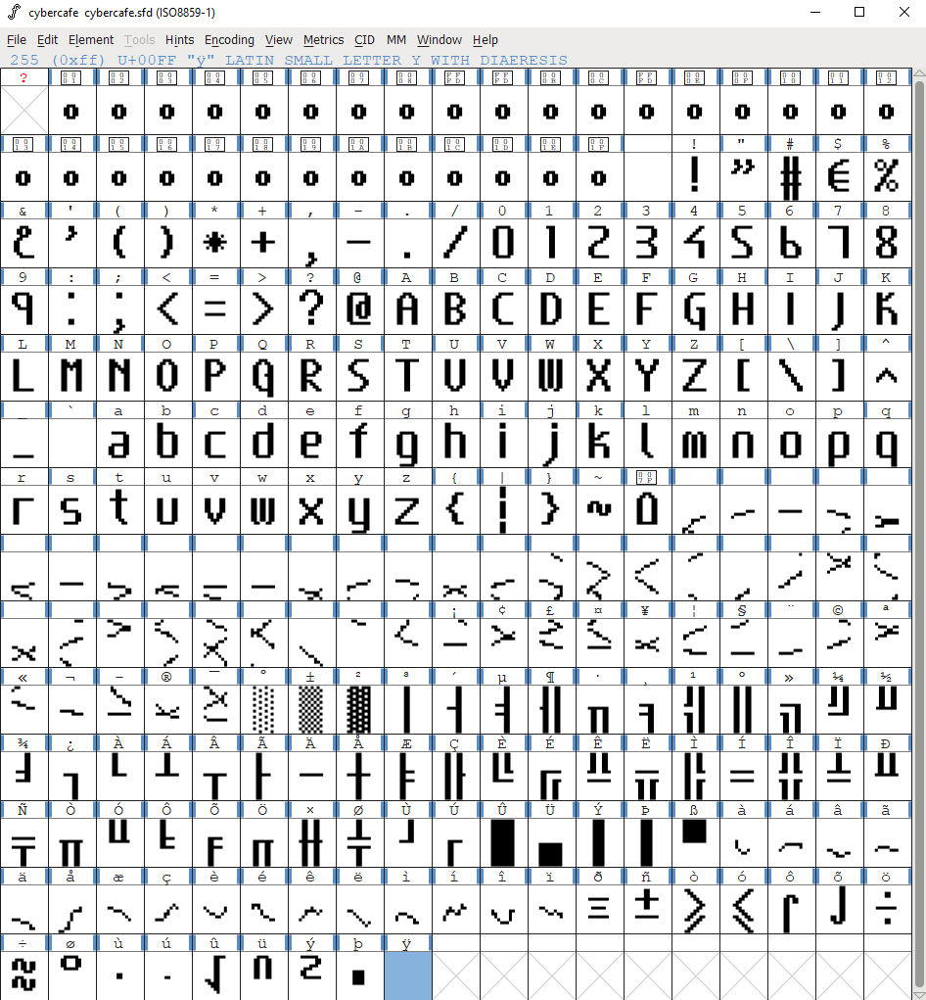
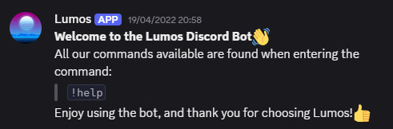
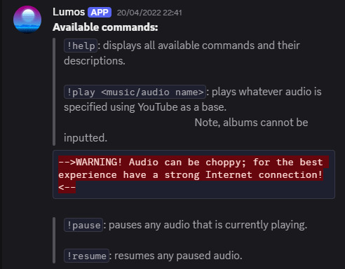
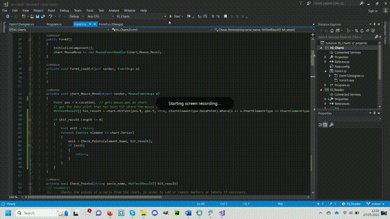

<h1 align=center>0larszl0</h1>
<strong>Hi!</strong>

 
 

I am <strong>Oliver Winhammar</strong> (<code>0larszl0</code>), a <i>First Class</i> Artificial Intelligence Graduate, Martial Artist, and DIY Enthusiast. Instead of sharing my life story, I have provided a compilation of all the projects I have been involved in, whether it was out of pleasure or for an educational or professional endeavour.

 

<h3>
<pre>
//-----------------------------------\\
|&nbsp;&nbsp;&nbsp;&nbsp;My most accomplished projects&nbsp;&nbsp;&nbsp;&nbsp;|
\\-----------------------------------//
</pre>
</h3>
   
<h4>1. <a href="https://github.com/0larszl0/SuperHotLogin">SuperHotLogin</a> ☆</h4>
<table>
   <tr>
      <td width="70%">
         SuperHotLogin is a QML project that was made for SDDM logins. The design used within it is meant to relate to old style monitors while giving a futuristic vibe to it. To date it is <strong>my most starred</strong> project and has been very successful in reddit groups: <code>r/unixporn</code> <code>r/linuxporn</code>, that value ricing on linux distributions.
      </td>
      <td width="30%">
         
      </td>
   </tr>
</table>

<h4>2. <a href="https://github.com/0larszl0/Cybercafe">Cybercafe</a> ☆</h4>
<table>
   <tr>
      <td width="70%">
         A restoration project to bring the old linux console font: "cybercafe.fnt", into the modern world.
      </td>
      <td width="30%">
         
      </td>
   </tr>
</table>

<h4>3. <a href="https://github.com/0larszl0/Firefox-LEGACY">Firefox-LEGACY</a></h4>
<table>
   <tr>
      <td width="70%">
         A custom firefox CSS that will be displayed instead of your boring default page when you enter a New Tab.
      </td>
      <td width="30%">
         
      </td>
   </tr>
</table>

 

<h3>
<pre>
//------------------------\\
|&nbsp;&nbsp;&nbsp;&nbsp;Private Prototypes&nbsp;&nbsp;&nbsp;&nbsp;|
\\------------------------//
</pre>
</h3>

The images and videos are included in the following projects:

<ul>
   <li><strong>Pygame related</strong>: Pacman, Pong & my own platform-shooter I named "<i>Iron Troopers</i>"</li>
   <li><strong>Discord bot</strong> named "<i>Lumos</i>"</li>
   <li><strong>Unity Projects</strong> for 2D, 3D and Virtual Reality</li>
   <li><strong>Stock Market Entries</strong></li>
</ul>

<table>
   <tr>
      <td width="33%">
         
      </td>
      <td width="33%">
         
      </td>
      <td width="33%">
         
      </td>
   </tr>
   <tr>
      <td width="33%">
         
      </td>
      <td width="33%">
         
         
      </td>
      <td width="33%" rowspan=2>
         
      </td>
   </tr>
   <tr>
      <td width="33%">
         
      </td>
      <td width="33%">
         
      </td>
   </tr>
</table>

Other unseen projects include: a virtual assistant named "<i>Edith</i>", and experiments into <i>AI music generation</i>.

